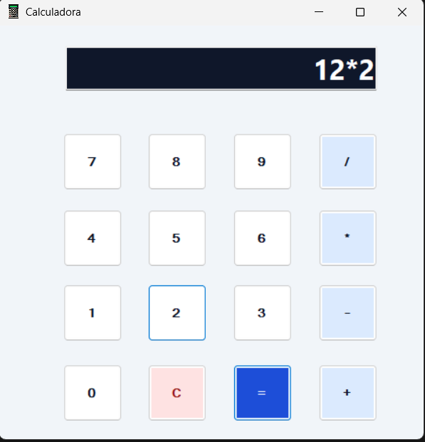
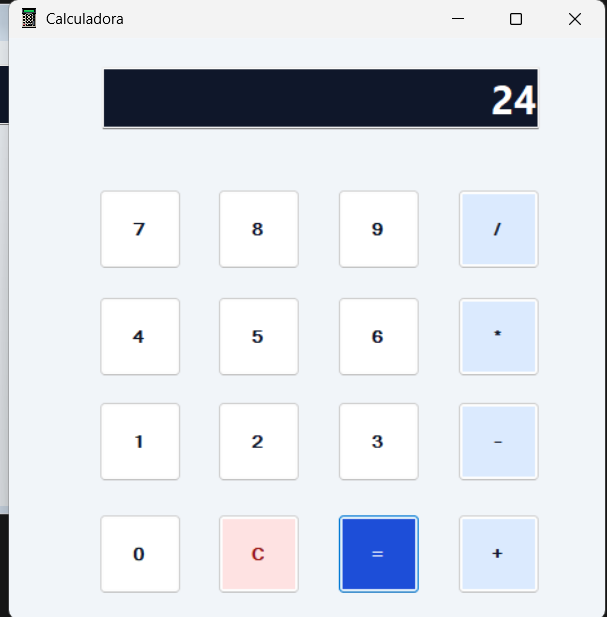
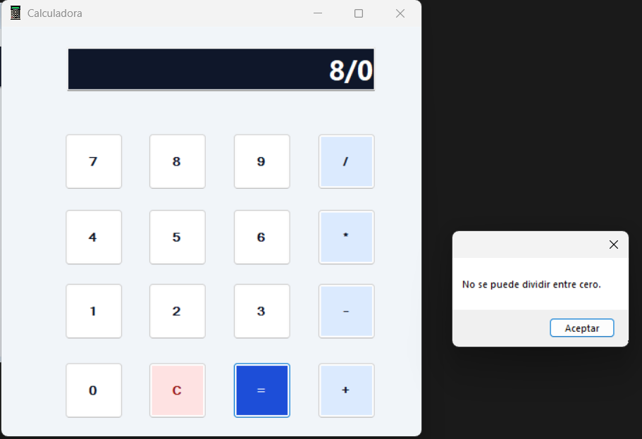

# Calculadora de escritorio

Proyecto individual PPE03 de Diseño y Programación de Software, Escuela Politécnica Nacional.

## Descripción

Calculadora de escritorio desarrollada en C# con Windows Forms. Permite ingresar números con un teclado de botones, combinar operaciones aritméticas y visualizar el resultado en una pantalla de solo lectura.

## Objetivos

- Aplicar la programación orientada a eventos mediante los botones de Windows Forms.
- Implementar las cuatro operaciones aritméticas y respetar la prioridad de la multiplicación y la división.
- Diseñar una interfaz legible e informar al usuario cuando una operación está incompleta o intenta dividir entre cero.

## Funcionalidades

- Teclado numérico con botones del 0 al 9.
- Suma, resta, multiplicación y división.
- Botón `=` para calcular y botón `C` para limpiar la pantalla e iniciar otra cuenta.
- Pantalla alineada a la derecha y botones diferenciados por color. El azul intenso destaca el botón `=` y el rojo claro identifica el botón `C`.
- Validación de números y expresiones incompletas. La aplicación muestra un aviso al intentar dividir entre cero.

## Tecnologías y requisitos

- Windows, C# y Windows Forms.
- Framework de destino del proyecto: .NET Framework 4.7.2.
- Visual Studio con la carga de trabajo **Desarrollo de escritorio de .NET**.
- Paquete de destino de .NET Framework 4.7.2 para compilar el proyecto.
- Git para clonar el repositorio.

## Instalación y ejecución

1. Copia la URL HTTPS del repositorio desde **Code → HTTPS** en GitHub.
2. Abre Git Bash y ejecuta estos comandos. Sustituye `https://github.com/galocv04/PPE03_Castillo_Galo_Calculadora.git` por el enlace que copiaste.

   ```bash
   git clone https://github.com/galocv04/PPE03_Castillo_Galo_Calculadora.git
   cd calculadora-ppe03
   ```

3. Abre en Visual Studio el archivo de solución `.sln` o `.slnx`. También puedes abrir directamente el archivo `.csproj` del proyecto.
4. Pulsa **F5**. Ingresa una operación con los botones y pulsa `=`. Usa `C` para empezar otra cuenta.

## Estructura del proyecto

| Archivo o carpeta | Contenido |
| --- | --- |
| `Program.cs` | Punto de entrada de la aplicación. |
| `Form1.cs` | Eventos de los botones, validaciones y lógica de cálculo. |
| `Form1.Designer.cs` | Configuración de los controles del formulario. |
| `Form1.resx` | Recursos asociados al formulario. |
| `*.csproj` | Configuración del proyecto y framework de destino. |
| `capturas/` | Imágenes de la aplicación en funcionamiento. |

## Capturas de funcionamiento

### Ingreso de una multiplicación



### Resultado de la multiplicación



### División por cero



## Pruebas

| Caso | Resultado esperado | Evidencia o estado |
| --- | --- | --- |
| Multiplicación `12 * 2` | `24` | Verificado en las capturas. |
| División por cero `8 / 0` | Aviso de división por cero. | Verificado en la captura. |
| Suma `10 + 5` | `15` | Por verificar. |
| Resta `20 - 8` | `12` | Por verificar. |
| División `100 / 4` | `25` | Por verificar. |
| Operación incompleta `12 +` | Aviso para completar la operación. | Por verificar. |
| Limpiar con `C` | Pantalla vacía. | Por verificar. |
| Dos cuentas consecutivas `3 * 3`, `C`, `8 + 2` | `9` y luego `10`, sin cerrar la aplicación. | Por verificar. |
| Prioridad de operaciones `5 + 6 * 7` | `47` | Por verificar. |

## Autor

Galo Castillo Vargas  
Escuela Politécnica Nacional
